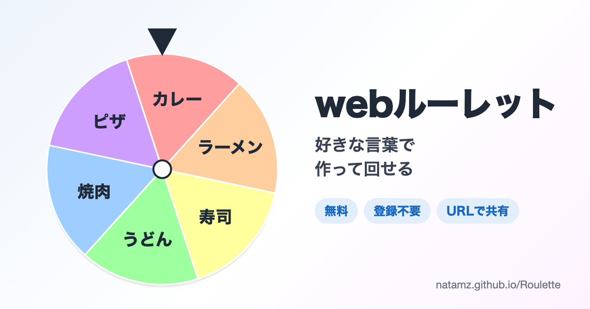

# Roulette

webルーレット（英語版は Wheel Spinner）は、好きな言葉を入れるだけでオリジナルのルーレットを作って回せる無料の Web アプリです。登録不要・スマホ対応。

- 日本語: <https://natamz.github.io/Roulette/>
- English: <https://natamz.github.io/Roulette/en/>



## 主な機能

- 項目ごとに当たりやすさ（1〜10）と色を変えられる
- ドラッグで並び替え。スマホは左にスライドで削除
- テンプレート（さいころ・〇X・じゃんけん）
- 作ったルーレットを URL で共有
- 回転時間・効果音の設定、ダークモード
- 項目と設定はブラウザ（IndexedDB / localStorage）にだけ保存。サーバーはありません

## 技術構成

- Nuxt 4（静的サイト生成）/ Vue 3 / Vuetify 3
- @nuxtjs/i18n（`/` が日本語、`/en/` が英語）
- Dexie（IndexedDB）
- `main` に push すると、GitHub Actions で GitHub Pages にデプロイ

## 開発

Node.js 24（`.nvmrc`）と npm を使います。

```bash
npm install
npm run dev        # 開発サーバ http://localhost:3000
```

### 検証

```bash
npm run lint       # ESLint
npm run typecheck  # 型チェック
npm test           # ユニットテスト（Vitest）
npm run test:e2e   # E2E（Playwright。静的サイトを生成して確認）
```

E2E を初めて動かすときは、`npx playwright install chromium` でブラウザを入れてください。

### 静的サイトの生成

```bash
NUXT_APP_BASE_URL=/Roulette/ npm run generate   # 成果物は dist/
```

`NUXT_APP_BASE_URL` は公開するパスに合わせます（ルートで配信するなら `/`）。
